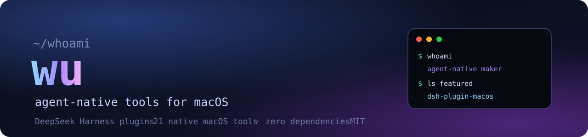

  

<h1 align="center">wu</h1>

  <b>I build small, sharp tools with AI agents — mostly for macOS and the
  <a href="https://github.com/deepseek-ai/deepseek-harness">DeepSeek Harness</a> ecosystem.</b>

  
  
  
  

---

## Now

- 🔭 Building **[`dsh-plugin-macos](https://github.com/wu04186767/dsh-plugin-macos)** — 21 native macOS tools
  for DeepSeek Harness agents: notifications, clipboard, screenshots, speech, keep-awake, dark mode,
  Spotlight, Shortcuts, AppleScript and real Safari control. Zero dependencies, MIT.
- 🧪 Exploring local-first agents that can actually operate a Mac — with honest permissions and no cloud.
- 🛠️ Working with JavaScript / Node.js, macOS automation (AppleScript, JXA, ``osascript``) and dsh plugin bundles.

## Featured

| Repo | What it is |
|---|---|
| **[dsh-plugin-macos](https://github.com/wu04186767/dsh-plugin-macos)** | Native macOS superpowers for your DeepSeek Harness agent — 21 local tools, no cloud, no browser extension, no npm dependencies. |
| **[wuruoyu-birthday](https://github.com/wu04186767/wuruoyu-birthday)** | A small HTML birthday page. |

## GitHub

  
  

## Elsewhere

- Open an issue on any repository — I read them.
- Built on macOS with DeepSeek Harness. Everything is a plugin.

Human + agent, shipping together.

